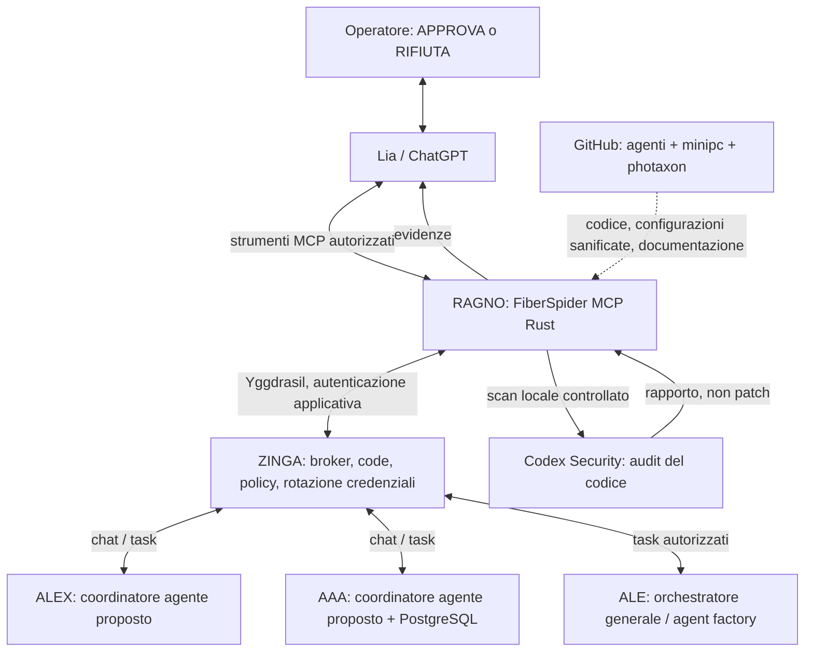

# LIA | Mappa mentale: sciame di agenti sicuri su Yggdrasil

> **Memoria progettuale** — 19 novembre 2026 · Repository `zinga0328it/agenti` · Ramo `lia`
>
> **Stato:** progetto e piano di lavoro. **Non** significa che la chat tra agenti, la rotazione delle credenziali o il flusso di approvazione via MCP siano già implementati. Nessuna configurazione LIVE deve essere cambiata in base a questo documento senza verifica e consenso dell'operatore.

## 1. Obiettivo finale

Costruire una **chat tecnica privata e persistente tra agenti e coordinatori AI**, distribuiti tra mini-PC Linux e collegati tramite **Yggdrasil**, con:

- **ALEX ↔ AAA:** i coordinatori si scambiano messaggi, richieste, risposte e stati di avanzamento tramite la mesh privata.
- **ZINGA:** broker/relay autenticato; inoltra e mette in coda messaggi, applica autorizzazioni. Coordina la *rotazione delle credenziali* senza diventare il proprietario delle chiavi private di ogni nodo.
- **RAGNO:** connettore Rust **FiberSpider MCP** verso Lia/ChatGPT, API e laboratorio Photaxon; ponte autorizzato verso la chat degli agenti.
- **ALE:** orchestrazione/fabbrica agentica generale già prevista nell'architettura di `agenti`; da integrare senza confonderlo con ALEX.
- **Lia:** interfaccia di supervisione e revisione; presenta proposte e risultati all'operatore quando la sessione e gli strumenti MCP lo consentono.
- **Operatore umano:** unica autorità finale per approvare modifiche e operazioni sensibili.
- **Codex Security:** revisione del codice e delle modifiche proposte, **mai** patch/deploy automatici.

Principio: **sciame dinamico, comando coordinato, confini di privilegio separati e decisione umana verificabile.**

## 2. Mappa mentale / topologia obiettivo



**Nota sulle architetture esistenti:** `agenti/memoria/ARCHITETTURA.md` prevede già un percorso **ALEX → ZINGA → AAA → ALE** per le richieste della fabbrica Servicess, e definisce ALEX come frontend statico. Il nuovo *coordinatore sul PC ALEX* è una **modifica architetturale da valutare e approvare**: potrebbe essere un processo isolato non esposto via Apache oppure una funzione ospitata altrove. Non sovrascrivere tacitamente la regola esistente.

### Confini di responsabilità

| Nodo / componente | Ruolo previsto | Confine |
|---|---|---|
| ALEX | Apache2/sito; eventuale coordinatore di nodo da approvare | Non esporre a Internet il canale di chat/agenti |
| AAA | PostgreSQL autorevole; eventuale coordinatore di nodo | Nessuna shell/SQL arbitraria da messaggi |
| ZINGA | Broker, code, ACL, consegna, revoca/rotazione coordinata | Non detenere tutte le chiavi private; non fidarsi dei soli IP |
| RAGNO | MCP ChatGPT, Rust/Axum/Tokio, integrazione Codex Security | Solo percorsi e operazioni esplicitamente autorizzati |
| ALE | Orchestratore centrale e fabbrica di agenti | Deleghe limitate; non accesso root universale |
| Lia | Supervisione e presentazione approvazioni | Nessuna presunta chiamata proattiva a una chat non attiva |

## 3. I tre repository sono distinti, ma collegati concettualmente

1. **AGENTI** — https://github.com/zinga0328it/agenti — architettura, memoria, protocollo chat, coordinatori, agent factory. **Ramo `lia`** per il presente progetto; `main` solo dopo revisione.
2. **MINIPC** — https://github.com/zinga0328it/minipc — agenti Linux e configurazioni modulari: nftables (`core.conf`, moduli include), Fail2ban, Falco, Yggdrasil, Apache2, Tor, Cloudflare, systemd, backup, deploy/rollback.
3. **PHOTAXON** — https://github.com/zinga0328it/photaxon/tree/pc-ragno — sorgenti Rust reali di RAGNO, MCP FiberSpider, API, laboratorio FTTH, integrazione AAA. Altri rami descrivono AAA e ALEX.

**Decisione Git:** per ora usare riferimenti/versioni espliciti e link tra repository. Valutare **Git submodule** soltanto dopo aver stabilito la struttura e verificato che non complichi i workflow; i repository **non sono ancora stati collegati tecnicamente come submodule**.

## 4. Stato verificato il 19/11/2026 (da sessione terminale)

### Già presente / verificato

- Su RAGNO: `/home/ragno/apps/photaxon/rust/Cargo.toml` contiene Rust edizione 2024, `rmcp 3.9`, `axum 0.8`, `sqlx 0.8`, `tokio`.
- Sorgenti individuati: `rust/src/lia_mcp.rs`, `rust/src/mcp/`, `rust/src/bin/ragno-lia-mcp.rs`.
- **16 file agent Copilot locali** individuati su RAGNO: 14 in `~/.copilot/agents/` e 2 in `/home/ragno/apps/photaxon/.github/agents/` (`photaxon-lab` e `lia-fiberspider-mcp`). La presenza dei file **non dimostra** che siano tutti attivi.
- `lia-fiberspider-mcp.agent.md` creato/completato localmente; governance, infrastruttura, API, sciame, sicurezza e primo audit presenti. **Verificare Git status e tracking prima di affermare che sia pubblicato.**
- CLI `codex`, `codex-security` e `copilot` disponibili su RAGNO.
- `codex-security login status` ha riportato **Logged in using ChatGPT**; CLI locale osservato `0.8.3` (upgrade `0.10.1` proposto dal tool, non eseguito).
- `codex mcp add codex-security -- codex-security --mcp` eseguito: `codex mcp list` indica server `codex-security` **enabled**.
- `codex-security mcp doctor`: `ok: true`, **1 solo tool esposto: `info`**. Di conseguenza **non è ancora possibile chiedere una scansione tramite quel solo tool MCP**.
- `codex-security scan --help` conferma `--auth chatgpt`, `--headless`, `--json`, `--dry-run`, `--path`, `--working-tree`, `--mode deep`. Nessuna scansione di questo progetto è stata dichiarata eseguita.
- File esistenti in GitHub verificati nei repository `agenti`, `minipc` e `photaxon`; nessun deploy avviato durante la creazione di questa memoria.

### Non ancora implementato / da verificare

- Tool FiberSpider MCP `security_scan` per scansioni Codex Security controllate.
- Chat persistente tra coordinatori ALEX/AAA; code, ACK, recupero messaggi.
- Broker ZINGA con ACL/identità e sistema di revoca/rotazione credenziali per gli agenti.
- Workflow effettivo `request_approval`/ `approve` / `reject` tramite Lia e MCP con evidenze durevoli.
- Accertamento dello stato reale dei servizi su tutti i nodi e delle identità Yggdrasil.
- Pubblicazione del nuovo agente locale `lia-fiberspider-mcp.agent.md` nel ramo Photaxon appropriato (solo dopo verifica e approvazione).
- Collegamenti Git tecnici (submodule, CI, release) tra i tre repository.

## 5. Protocollo della chat degli agenti — proposta iniziale

**Envelope JSON versionato** con campi essenziali:

```json
{
  "protocol_version": "1",
  "message_id": "uuid",
  "task_id": "uuid",
  "sender": "agent:alex-coordinator",
  "recipient": "agent:aaa-coordinator",
  "type": "task.proposal",
  "created_at": "ISO-8601",
  "expires_at": "ISO-8601",
  "nonce": "random-unique",
  "payload": {"action": "inspect", "scope": "approved-module"},
  "signature": "detached-signature-reference"
}
```

I valori qui sopra sono **segnaposto**, non credenziali reali né un'API già funzionante. Il formato concreto, la firma, l'autenticazione dei mittenti e il catalogo dei tipi di messaggio sono da definire e testare.

Funzioni proposte: `send_message`, `receive_messages`, `ack_message`, `create_task`, `task_status`, `request_approval`, `submit_decision`, `security_scan`, `audit_log`.

Requisiti: idempotenza, ordine/ritentativi definiti, scadenza, anti-replay, messaggi non eseguibili direttamente, cifratura, limiti dimensione/frequenza, audit, isolamento dei job e code persistenti. **Nessun messaggio deve diventare automaticamente un comando shell.**

## 6. Sicurezza delle chiavi e dei coordinatori

- **Yggdrasil protegge il trasporto mesh**, ma non sostituisce autenticazione applicativa, autorizzazione per azione, firma dei messaggi, segregazione dei processi e protezione degli endpoint.
- Ogni agente ha **identità e chiave privata proprie**, conservate sul proprio nodo. ZINGA può fare da broker per registrazione, distribuzione di **chiavi pubbliche/certificati** e procedure di rotazione/revoca; il design deve evitare che il compromesso del broker consegni automaticamente tutte le identità.
- Preferire **credenziali a breve durata**, rotazione periodica e di emergenza, revoca, audit e separazione del componente emittente/trust root dal relay quando possibile.
- Per la chat, valutare **autenticazione reciproca TLS** e firme a livello messaggio; se ZINGA non deve leggere il contenuto, progettare anche cifratura end-to-end. Non presumere che mTLS da solo offra E2E.
- Policy per agente e azione: least privilege, allowlist, niente `sudo ALL`, niente esecuzione shell arbitraria, niente riutilizzo di approvazioni tra task.
- Gestire nodo offline, broker compromesso, chiave rubata, clock skew, messaggio duplicato, revoca, replay, ripristino e fail-closed.
- **Obiettivo: ridurre e contenere il rischio, non promettere sistemi inviolabili.**

## 7. Flusso approvazioni: Lia + MCP + operatore

```text
Agente Copilot / Codex -> PROPOSTA (diff, scopo, rischio, rollback)
     -> Orchestratore -> stato PENDING + ID univoco
     -> Tool MCP visibile a Lia quando disponibile nella sessione
     -> Lia illustra all'operatore
     -> OPERATORE APPROVA / RIFIUTA
     -> decisione autenticata e registrata con scope/hash/scadenza
     -> agente autorizzato esegue SOLO la proposta approvata
     -> test / audit / report finale -> Lia
```

Stati: `PENDING`, `APPROVED`, `REJECTED`, `EXPIRED`, `EXECUTING`, `COMPLETED`, `FAILED`.

**Vincolo tecnico:** il server MCP di RAGNO può essere interrogato tramite strumenti connessi. Non assumere di poter *chiamare autonomamente Lia dentro una conversazione ChatGPT* o ricevere approvazioni a chat chiusa. Progettare una coda durevole e un meccanismo di lettura/consultazione tramite strumenti realmente supportati. Nessuna autorizzazione implicita al timeout.

## 8. Moduli Linux e agenti specializzati

Obiettivo: un agente responsabile per ogni **servizio/area autorizzata**, non un solo agente con accesso totale.

| Agente | Area tecnica | Vincolo |
|---|---|---|
| nftables | `core.conf`, `conf1.conf`/moduli include effettivi | verificare percorsi reali; `nft -c -f`, rollback, preservare SSH |
| Fail2ban | jails, filters, actions | test `fail2ban-regex`, nessun ban indiscriminato |
| Falco | regole, eventi e alert | validare configurazione/regole, non disabilitare detection |
| Yggdrasil | peering, ACL e connettività privata | identità privata mai in Git; rollback rete |
| Apache2 | vhost/reverse proxy e certificati | `apachectl configtest`, nessuna esposizione non voluta |
| Tor / Cloudflare | tunnel e onion autorizzati | segreti esclusi da Git; review ACL |
| Rust/MCP | router, gateway, tools, broker | test, allowlist, timeout, audit; no comando libero |
| DB PostgreSQL | schemi/ruoli limitati | backup/restore verificato, migrazioni approvate |

**Niente deploy in produzione** senza backup, lint/validazione, test mirati, piano di recupero e autorizzazione umana. Per nuovo software di sistema preferire Rust quando appropriato; per nftables/Fail2ban/Falco utilizzare i formati e i tool nativi.

## 9. Roadmap passo passo con criteri di completamento

| Fase | Attività manuale insieme a Lia | Uscita verificabile |
|---|---|---|
| **0. Memoria** | Scrivere questa mappa nel ramo `lia` di `agenti` | Documento e link GitHub |
| **1. Audit** | Leggere `rust/src/mcp/AGENTS.md`, `lia_mcp.rs`, i binari, `AGENTS.md`, stato Git e servizi | Inventario reale senza modifiche |
| **2. Contratti** | Definire protocollo JSON, ruoli, ACL, retry, stati task/approvazioni e versioning | Specifica approvata |
| **3. Sicurezza** | Progettare identità, trust root, mTLS/firme, revoca, rotazione chiavi e threat model | Test di autenticazione/revoca |
| **4. Prototipo locale** | Scrivere in Rust una chat tra **due agenti fittizi** in laboratorio RAGNO | Invio, risposta, ACK, log, offline |
| **5. Broker ZINGA** | Aggiungere coda, ACL, autenticazione, inoltro via Yggdrasil | Test su rete privata e fail-closed |
| **6. ALEX ↔ AAA** | Risolvere il conflitto architetturale ALEX frontend-only; poi coordinatori isolati | Messaggi verificati fra i nodi |
| **7. MCP Lia** | Esporre consultazione chat, task e approvazioni tramite FiberSpider MCP | Lia legge la coda; decisioni correlate all'ID |
| **8. Codex Security** | Implementare **`security_scan`** in Rust: percorsi allowlist, `--auth chatgpt`, no `--patch`, timeout, output sanificato | Scan reale di test e rapporto leggibile |
| **9. Specialisti** | Integrare agenti nftables, Fail2ban, Falco, Yggdrasil, Apache2, Tor ecc. | Permessi minimi e test per modulo |
| **10. GitHub** | Documentare codice e runbook nei tre repo, verificare segreti, collegamenti e PR | Branch, commit, documenti e audit |
| **11. Avvio controllato** | Backup, rollback, simulazione guasti, revisione dei risultati e consenso umano | Deploy graduale e verifiche post-avvio |

**Regola di lavoro:** un comando alla volta sul terminale RAGNO, spiegazione del perché, controllo dell'output, nessuna improvvisazione sui file LIVE. **Documentare e pubblicare il materiale approvato prima dell'avvio della nuova rete di agenti.**

## 10. Prossima azione precisa (non perdere il filo)

RIPRENDERE DA QUI: **Fase 1 / Audit in sola lettura** del connettore Rust su RAGNO.

Comando da eseguire dall'operatore su RAGNO:

```bash
cat /home/ragno/apps/photaxon/rust/src/mcp/AGENTS.md
```

Poi leggere la struttura di `src/lia_mcp.rs` e localizzare la registrazione dei tool esistenti **prima** di inserire `security_scan`. Controllare inoltre Git branch/status, senza scrivere codice finché il piano non è verificato.

## 11. Decisioni ancora aperte

1. Dove eseguire davvero il coordinatore ALEX, rispettando o revisionando l'attuale regola frontend-only.
2. Dove ospitare la coda persistente dei messaggi e chi può leggerla (non usare senza progetto il DB FTTH di AAA).
3. Quale componente emette le identità/certificati, e come si gestiscono rotazione, revoca ed emergenze.
4. Se il broker debba conoscere il testo dei messaggi o soltanto trasportare payload E2E.
5. Come integrare Copilot/Codex CLI realmente supportati, senza presumere una chat multi-agente già disponibile.
6. Come esporre a Lia coda/scansioni/approvazioni via MCP, senza affidarsi a chiamate proattive non supportate.
7. Se e quando usare submodule tra `agenti`, `minipc` e `photaxon`.

## 12. Fonti di progetto da rileggere

- [AGENTI — regole del repository](https://github.com/zinga0328it/agenti/blob/main/AGENTS.md)
- [AGENTI — architettura ALE esistente](https://github.com/zinga0328it/agenti/blob/main/memoria/ARCHITETTURA.md)
- [MINIPC — moduli e regole agenti](https://github.com/zinga0328it/minipc/blob/main/AGENTS.md)
- [PHOTAXON — ramo RAGNO](https://github.com/zinga0328it/photaxon/tree/pc-ragno)
- [PHOTAXON — connettore Lia](https://github.com/zinga0328it/photaxon/blob/pc-ragno/rust/src/lia_mcp.rs)
- [PHOTAXON — avvio connettore](https://github.com/zinga0328it/photaxon/blob/pc-ragno/rust/src/bin/ragno-lia-mcp.rs)

---

**Promemoria di Lia:** non si perde il lavoro, non si confonde ALE con ALEX, non si sacrifica la sicurezza per la velocità e **nessun agente decide l'approvazione al posto dell'operatore**.
